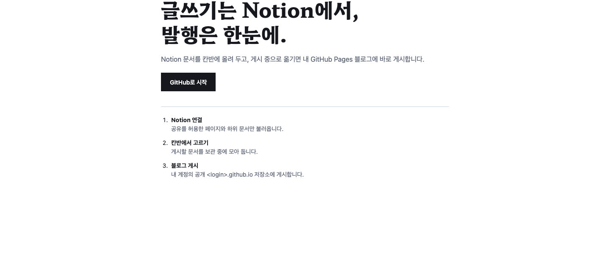
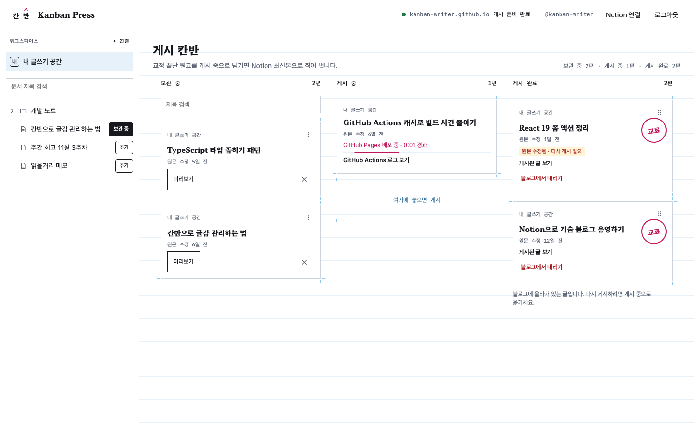
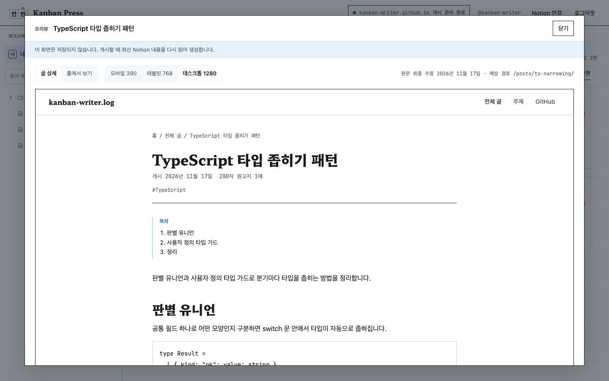
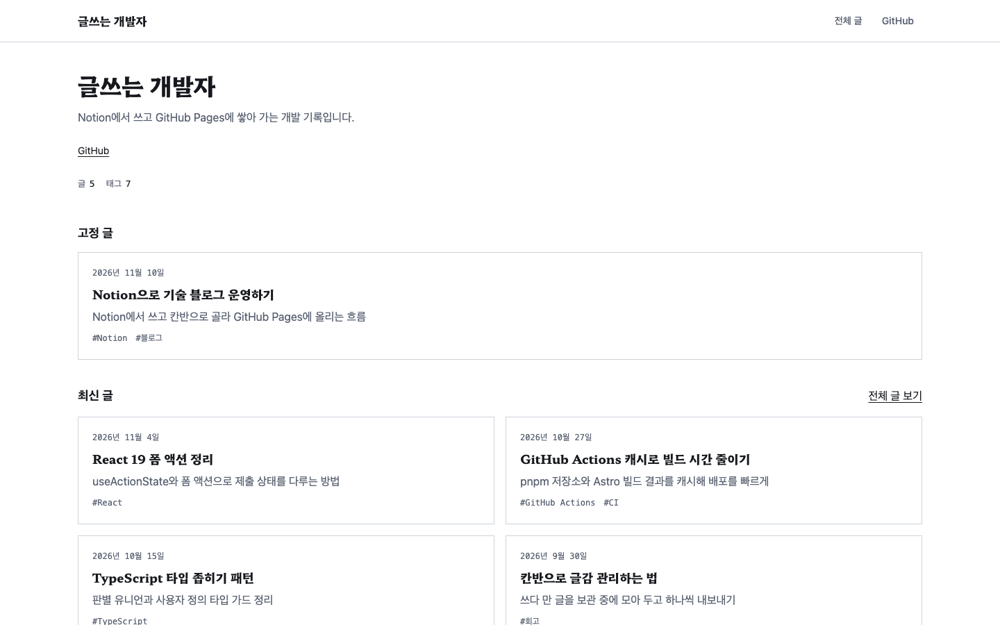

  

# Kanban Press

> Notion에 쓴 글을 칸반으로 골라 내 GitHub Pages 블로그에 게시하는 서비스

Notion에 글을 쓰는 사람이 블로그에 올리려면 글을 옮겨 붙이고, 이미지를 내려받고, 정적 블로그를 직접 빌드해야 합니다.
Kanban Press는 GitHub로 로그인하고 Notion을 연결하면 올릴 글을 칸반 카드로 모아 두고, 카드를 `게시 중` 열로 옮기는 것만으로 내 `<GitHub 아이디>.github.io` 블로그에 글을 올려 줍니다.
별도 서버 DB 없이 칸반 목록과 글이 모두 내 GitHub 저장소에 기록되므로, 같은 계정이면 어느 브라우저에서 열어도 같은 칸반을 봅니다.

## :fireworks: Screenshots

  
  

왼쪽: 로그인 전 소개 화면 · 오른쪽: 보관 중·게시 중·게시 완료 칸반과 원문 수정 알림

  
  

왼쪽: 게시 전 미리보기 · 오른쪽: 함께 만들어지는 블로그 홈

화면의 계정·문서·글은 모두 예시용 가상 데이터입니다.

## :pushpin: 주요 기능

- **GitHub 로그인과 블로그 저장소 확인**: GitHub 계정으로 로그인하면 내 공개 `<GitHub 아이디>.github.io` 저장소가 게시할 준비가 됐는지 바로 알려 줍니다.
- **Notion 연결과 문서 탐색**: Notion 워크스페이스를 최대 3개까지 연결하고, 공유한 페이지와 하위 페이지를 계층 그대로 펼쳐 보며 블로그에 올릴 문서를 고릅니다.
- **칸반으로 글 정리**: 고른 문서는 `보관 중`, 올리는 중인 글은 `게시 중`, 블로그에 있는 글은 `게시 완료` 열에 보입니다. 마우스와 키보드로 카드를 옮길 수 있고, 보관 중 문서는 제목으로 검색합니다.
- **게시 전 미리보기**: 올리기 전에 글 상세와 블로그 홈에 어떻게 보일지 여러 화면 폭으로 확인합니다.
- **카드를 옮기면 게시**: 카드를 `게시 중` 열에 놓으면 최신 Notion 원문과 이미지를 블로그 글로 바꿔 내 저장소에 올리고, GitHub Actions 배포가 끝날 때까지 진행 상태와 로그 링크를 보여 줍니다. 좁은 화면에서는 `게시` 버튼으로 같은 일을 합니다.
- **원문 수정 알림**: 게시한 뒤 Notion에서 글을 고치면 해당 카드에 `원문 수정됨 · 다시 게시 필요`가 표시됩니다.
- **글 관리**: 제목이나 주소를 바꿔 다시 올리면 옛 글을 정리하고 옛 주소에서 새 글로 안내합니다. `블로그에서 내리기`로 글을 내려도 Notion 원문은 그대로입니다.
- **블로그 설정**: 블로그 이름, 소개, 프로필 링크를 앱에서 바로 바꿉니다. Notion 속성 `Blog Slug`로 글 주소를, `Blog Pinned`로 홈 고정 글을, `Blog Tags`로 태그를 정할 수 있습니다.
- **함께 만들어지는 블로그**: 홈, 검색·태그 거르기·쪽 나누기가 있는 전체 글, 연·월 보관함, 목차가 있는 글 상세를 갖춘 반응형 블로그가 만들어지고 RSS·sitemap·Open Graph도 함께 생성됩니다.

## :footprints: 사용 흐름

1. **GitHub로 로그인**합니다. 공개 `<GitHub 아이디>.github.io` 저장소를 준비해 두면 게시 대상으로 확인됩니다.
2. **Notion을 연결**하고 블로그에 쓸 페이지를 공유합니다.
3. 문서 목록에서 올릴 글을 **`추가`해 칸반의 `보관 중`에 모읍니다**. 필요하면 미리보기로 모양을 확인합니다.
4. 카드를 **`게시 중`으로 옮기면** 글이 내 저장소에 올라가고, 배포가 끝나면 `게시 완료` 카드에서 블로그 글을 엽니다.

## :sparkles: 기술 스택

  
  
  
  
  
  

  
  
  

  
  
  
  

## :calendar: 개발 정보

- **개발 기간**: 2026.07.19 ~ 2026.11.12 (첫 커밋 ~ 마지막 커밋 기준)
- **개발 형태**: 개인 프로젝트

|  |
|:---:|
| [HappyDoran](https://github.com/HappyDoran) |

## :books: 개발 문서

- [개발 가이드](docs/DEVELOPMENT.md): 설치와 실행, GitHub·Notion 연결 설정, 검증 명령, 저장소 구조
- [제품 명세](docs/spec/PROJECT_SPEC.md): 요구사항과 저장·상태·흐름 계약
- [구현 현황](docs/spec/gap-analysis.md): 요구사항 대비 현재 상태와 백로그
- [아키텍처](docs/architecture/ARCHITECTURE.md): 런타임 구성과 요청 경계
- [기술 규칙](TECH_RULES.md), [작업 규범](AGENTS.md)
